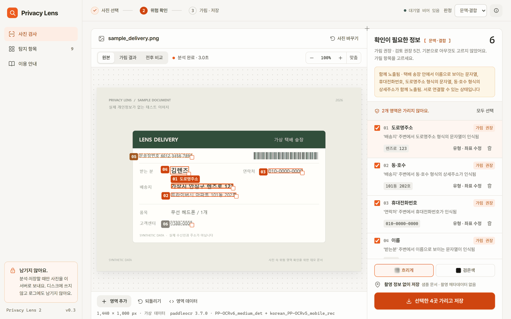
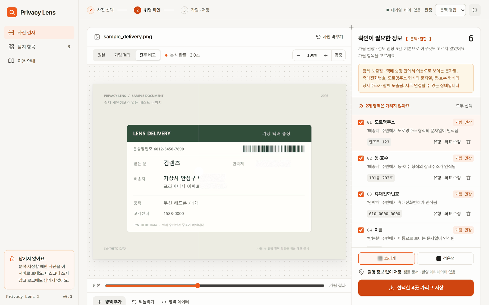
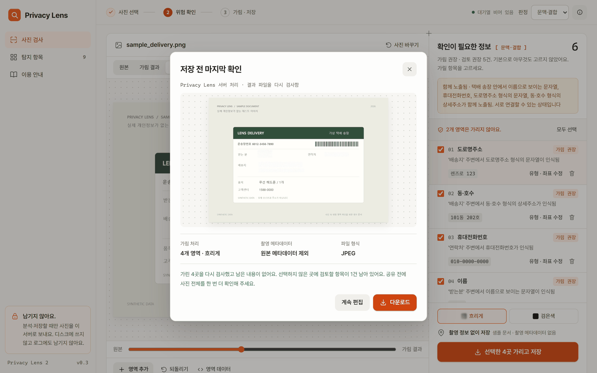
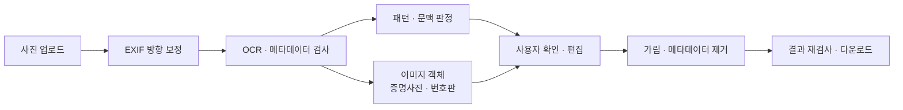

<div align="center">

# Privacy Lens

**사진을 공유하기 전, 배경 속 개인정보까지.**

택배 송장, 학생증, 모니터 화면에 담긴 개인정보를 찾아<br>
위치와 판단 근거를 보여 주고, 선택한 영역을 가린 사본을 만듭니다.


[주요 기능](#주요-기능) · [시작하기](#시작하기) · [분석 방식](#분석-방식) · [개발 안내](#개발-안내) · [문서](#문서)

수원대학교 정보보호학과 · 시스템보안프로젝트 · 2026학년도 2학기 · 5인 팀

</div>



## 주요 기능

Privacy Lens는 SNS나 중고거래에 사진을 올리기 전, 배경에 함께 찍힌 개인정보를 확인하는 웹 서비스입니다. 분석 결과를 바탕으로 사용자가 가릴 영역을 선택하고 수정할 수 있습니다.

| 기능 | 설명 |
|---|---|
| **개인정보 탐지** | 이름, 전화번호, 이메일, 주소, 주민등록번호, 카드번호, 계좌번호, 비밀번호, 학번·사번, 운송장번호, 차량번호와 QR·바코드, EXIF 위치정보를 확인합니다. 이름은 라벨이 있거나 연락처·명찰 같은 단서가 함께 있을 때 탐지합니다. |
| **이미지 객체 탐지** | 글자가 아닌 개인정보를 찾습니다. 신분증·학생증 위의 **증명사진**(OpenCV YuNet 얼굴 + 카드 단서)과, OCR 이 글자를 못 읽은 **차량 번호판**(우리가 학습한 YOLO26 모델, `models/plate.onnx`)을 영역으로 알립니다. 회전 정보가 지워진 누운 사진도 돌려서 찾습니다. 과정과 측정은 [이미지 객체 작업 기록](docs/OBJECTS_REPORT.md). |
| **근거와 우선순위 표시** | 각 항목을 가림 권장·검토 권장·참고로 구분하고, 주변 문구와 함께 판단 근거를 보여 줍니다. |
| **영역 선택과 편집** | 탐지된 영역을 선택하거나 수정하고, 놓친 영역은 직접 추가할 수 있습니다. |
| **미리보기와 저장** | 서버에서 가림 처리를 적용한 결과를 미리 보여 주고, 메타데이터 제거와 결과 파일 재검사를 거쳐 사본을 제공합니다. |

### 사용 흐름

1. **사진 선택** — 사진을 올리거나 가상 정보로 만든 샘플을 선택합니다.
2. **결과 확인** — 사진에 표시된 영역과 항목별 판단 근거를 확인합니다.
3. **가릴 영역 편집** — 필요한 항목을 선택하고, 놓친 영역을 직접 지정합니다.
4. **미리보기·저장** — 흐리게 또는 검은색 가림을 적용한 결과를 확인하고 사본을 내려받습니다.

<table>
  <tr>
    <td width="50%"></td>
    <td width="50%"></td>
  </tr>
  <tr>
    <td align="center"><b>전후 비교</b><br>서버에서 가림 처리한 결과를 미리 확인합니다.</td>
    <td align="center"><b>결과 저장</b><br>재검사 결과를 확인하고 사본을 내려받습니다.</td>
  </tr>
</table>

> 탐지 결과에는 누락이 있을 수 있습니다. 저장 전 미리보기에서 사진 전체를 확인하고, 필요한 영역을 직접 추가해 주세요.

## 시작하기

기본 OCR 엔진은 PaddleOCR이며, 처음 실행할 때 모델 가중치를 내려받습니다. 아래 설치 안내는 **일반 CPython 3.10~3.13**을 기준으로 합니다. Linux용 PaddlePaddle 3.2.2 패키지는 이 범위의 `x86_64`·`aarch64` 환경에 제공되며, Python 3.14 이상이나 다른 환경에 그대로 적용할 수 없습니다. 패키지 제공 여부는 [공식 CPU 배포 목록](https://www.paddlepaddle.org.cn/packages/stable/cpu/paddlepaddle/)에서 확인할 수 있습니다.

### 설치 및 실행

```bash
git clone https://github.com/2026-usw-project/privacy-lens.git
cd privacy-lens
```

파이썬 가상환경 사용시 사용할 Python 버전을 확인하고 가상환경을 만듭니다. 다음은 **Python 3.12와 venv가 설치된 환경**의 예시입니다. 3.10·3.11·3.13을 사용한다면 첫 명령의 실행 파일 이름을 해당 버전으로 바꾸세요.

```bash
python3.12 -m venv .venv
source .venv/bin/activate
python --version
```

선택한 Python 환경에서 패키지를 설치합니다. PaddlePaddle은 저장소에서 동작을 확인한 3.2.2를 지정합니다.

```bash
python -m pip install --upgrade pip
python -m pip install -r requirements.txt
python -m pip install paddlepaddle==3.2.2 -i https://www.paddlepaddle.org.cn/packages/stable/cpu/
python -m pip install paddleocr
python run.py
```

실행 후 [http://127.0.0.1:8000](http://127.0.0.1:8000)에 접속합니다. 웹 화면과 API는 같은 주소에서 제공됩니다.

- `run.py`는 필요한 패키지, 한글 폰트와 OCR 환경을 점검합니다. 누락된 항목이 있으면 설치 방법을 안내합니다.
- 초기 준비 시간은 모델 다운로드 여부와 실행 환경에 따라 달라집니다. 화면 상단의 `OCR 엔진 준비 중` 표시가 `대기열 비어 있음`으로 바뀌면 분석을 시작할 수 있습니다.
- 화면의 샘플 3종으로 가상 송장·학생증·복합 문서의 분석 결과를 확인할 수 있습니다.
- HEIC 사진은 `pillow-heif`가 설치된 환경에서 지원합니다.

<details>
<summary><b>화면과 백엔드(API)를 따로 실행하기</b></summary>

`run.py`는 화면과 API를 한 서버(8000)에서 함께 띄웁니다. 둘을 나눠 띄우려면 창 두 개에서 각각 실행합니다.

```bash
python run_backend.py
```

```bash
python run_frontend.py
```

화면은 [http://127.0.0.1:8080](http://127.0.0.1:8080), API는 `http://127.0.0.1:8000`입니다.

| 스크립트 | 하는 일 | 주요 옵션 |
|---|---|---|
| `run_backend.py` | `run.py`와 같은 환경 점검 뒤 **API만** 띄웁니다(화면 없음, `PL_SERVE_FRONT=0`). 화면 서버 주소에서 오는 요청만 허용합니다(CORS). | `--host` `--port`(8000) `--cors`(허용할 화면 주소, 쉼표로 여러 개. 기본 이 컴퓨터의 8080) `--check` |
| `run_frontend.py` | **화면만** 내줍니다. 파이썬 기본 기능만 써서 OCR·패키지 설치가 필요 없습니다. 페이지에 API 주소를 넣어 줍니다. | `--host` `--port`(8080) `--api`(백엔드 주소, 기본 `http://127.0.0.1:8000`) |

- 다른 기기에서 접속하려면 두 서버를 `--host 0.0.0.0`으로 띄우고, 백엔드의 `--cors`에 화면 주소(`http://<화면 PC IP>:8080`)를, 화면의 `--api`에 백엔드 주소(`http://<백엔드 PC IP>:8000`)를 줍니다.
- 화면 파일은 빌드 결과(`web/frontend-demo/privacy-lens.html`)입니다. 화면을 고쳤으면 먼저 `node scripts/build.mjs`를 실행합니다.
- PC 웹캠 촬영은 https 또는 localhost에서만 됩니다(브라우저 규칙).

</details>

<details>
<summary><b>엔진 서버 여러 대에 나눠 돌리기(게이트웨이)</b></summary>

엔진(OCR) 하나가 CPU 를 거의 다 쓰므로, 한 PC 에서 작업자를 늘리기보다 **PC 마다 엔진 서버를 하나씩** 띄우고 게이트웨이가 나눠 보냅니다.

```
사용자 ──▶ 게이트웨이(화면 + 대기열 + 분산 + 상태 확인) ──▶ 엔진 서버 1..N (1 서버 1 엔진)
```

엔진 PC 마다(같은 비밀값을 정해 씁니다):

```bash
python run_backend.py --host 0.0.0.0 --token <비밀값>
```

게이트웨이 PC 에서(엔진 주소를 `--backend` 로 여러 번):

```bash
python run_gateway.py --host 0.0.0.0 --backend http://192.168.0.21:8000 --backend http://192.168.0.22:8000 --token <비밀값>
```

사용자는 게이트웨이 주소(`http://<게이트웨이 IP>:8080`)로 접속합니다. 화면과 API 가 같은 주소라 CORS 설정이 필요 없습니다.

- **대기열은 게이트웨이에 하나**입니다. 들어온 순서대로, 비어 있는 엔진이 생길 때 한 건씩 보냅니다. 아직 차례가 안 된 요청은 게이트웨이가 '앞에 N건 · 약 N초'를 직접 알려 줍니다.
- **번호표마다 엔진을 고정**합니다. 분석을 엔진 2 가 맡았으면 그 번호표의 진행 상황·취소도 엔진 2 로 갑니다.
- **상태 확인**: 5초마다 엔진의 `/health` 를 묻고, 응답이 없으면 빼고 살아나면 다시 넣습니다. 보내다가 연결이 안 되면(처리 전) 다른 엔진에 다시 보냅니다.
- **엔진은 게이트웨이만 받습니다.** `--token` 을 주면 같은 비밀값을 가진 요청만 처리하고 나머지는 403 입니다. 비밀값은 저장소에 적지 않습니다.
- 게이트웨이는 OCR·모델이 필요 없습니다(fastapi·uvicorn·httpx). 사진은 메모리에서만 엔진으로 넘기고 디스크·로그에 남기지 않습니다.
- 화면을 정적 호스팅에 따로 올릴 때는 `run_gateway.py --no-front --cors <화면 주소>` 로 API 만 띄웁니다.

</details>

환경 점검만 실행하려면 다음 명령을 사용합니다.

```bash
python run.py --check
```

저장소에서 확인한 PaddlePaddle 3.3.x CPU 추론 오류를 피하기 위해 설치 안내는 3.2.2를 사용합니다. 설치 문제와 세부 설정은 [개발 노트](docs/DEVELOPMENT.md#빠르게-실행)를 참고하세요.

<details>
<summary><b>Linux에서 No matching distribution found가 발생할 때</b></summary>

이 오류는 pip가 현재 환경과 버전 조건에 맞는 설치 파일을 찾지 못했다는 뜻입니다. 오류 문구만으로 원인을 확정할 수 없으므로 먼저 환경을 확인합니다.

```bash
python --version
uname -m
python -m pip --version
```

- **Python 버전:** 3.14 이상이면 위에서 안내한 3.10~3.13으로 새 가상환경을 만듭니다. 기존 가상환경의 Python 버전은 pip 업그레이드로 바뀌지 않습니다.
- **CPU·배포판:** 32비트 환경이나 Alpine Linux처럼 musl을 사용하는 환경은 일반 Linux 패키지와 호환되지 않을 수 있습니다. [공식 Linux 설치 조건](https://www.paddlepaddle.org.cn/documentation/docs/en/install/pip/linux-pip_en.html)을 확인합니다.
- **패키지 저장소:** 지원 환경에서도 오류가 나면 위 설치 명령처럼 공식 CPU 인덱스를 지정합니다. 앞선 로그에 연결·인증서·프록시 오류가 있는지도 확인합니다.

설치 후 추론 엔진을 확인할 수 있습니다.

```bash
python -c "import paddle; paddle.utils.run_check()"
```

</details>

<details>
<summary><b>Tesseract로 실행하기</b></summary>

[Tesseract와 한국어 데이터](docs/DEVELOPMENT.md#tesseract-설치)를 설치한 뒤 OCR 엔진을 지정합니다.

**Windows PowerShell**

```powershell
$env:PL_OCR = "tesseract"
python run.py
```

**macOS / Linux**

```bash
PL_OCR=tesseract python run.py
```

</details>

### 모델 받기·적용 (선택)

모델이 없어도 OCR·판단·가림은 그대로 동작합니다. 아래 모델을 두면 글자가 아닌 것(문서·카드 영역, 증명사진, 번호판)도 찾습니다.
가중치는 저장소에 올리지 않고 팀 구글 드라이브 `PrivacyLens-YOLO` 에만 둡니다(`models/` 폴더는 git 이 무시합니다).

| 모델 | 받을 곳 | 저장소에 둘 곳 | 서버가 쓰는 방법 |
|---|---|---|---|
| 얼굴·증명사진(YuNet) | OpenCV 공식 저장소 | `models/face_detection_yunet_2023mar.onnx` | 아래 `download` 명령이 받고 SHA-256 을 확인합니다 |
| 번호판 | 드라이브 `objects/plate_vNNN/best.onnx` (2026-11-03 추천: **v003**) | `models/plate.onnx` | 있으면 자동 사용(`PL_PLATE_MODEL` 로 경로 지정, `off` 로 끔) |
| 문서·카드 검출(YOLO) | 드라이브 `models/vNNN/` 의 `best.pt` 와 `metrics.json` | `models/vNNN/best.pt`, `models/vNNN/metrics.json` | 가장 큰 번호 폴더를 자동 사용(`PL_YOLO_WEIGHTS` 로 고정, `PL_YOLO=off` 로 끔) |

1. 검출 패키지(ultralytics·onnx·onnxruntime)를 설치합니다. GPU 로 돌리려면 `onnxruntime` 대신 `onnxruntime-gpu` 를 설치합니다(둘 중 하나만).

   ```bash
   python -m pip install -r vision/requirements.txt
   ```

2. 얼굴 모델을 받습니다.

   ```bash
   python -m pipeline.objects download
   ```

3. 드라이브에서 번호판 모델 `objects/plate_v003/best.onnx` 를 받아 이름을 바꿔 둡니다.

   ```
   models/plate.onnx
   ```

4. 드라이브에서 문서 검출 모델 폴더(예: `models/v005/`)의 `best.pt` 와 `metrics.json` 을 같은 이름의 폴더에 둡니다.
   `metrics.json` 에는 학습 입력 크기(`imgsz`)가 들어 있어 서버가 그대로 씁니다.

   ```
   models/v005/best.pt
   models/v005/metrics.json
   ```

5. 확인합니다. `얼굴 검출 YuNet (card)`, `번호판 검출 …plate.onnx` 가 `[OK]` 로 나오면 됩니다.
   문서 검출 모델은 분석 화면 하단에 `YOLO v005·yolo11 (CPU)` 처럼 보입니다.

   ```bash
   python run.py --check
   ```

알아 둘 것

- **시연 서버는 문서 검출 버전을 고정하세요.** 서버는 `models/` 에서 가장 큰 번호 폴더를 그냥 씁니다. v004·v005 는 실사 검증 사진이 0장이라(학습 사진 점수만 있음)
  새 폴더를 복사하는 순간 검증 안 된 모델로 바뀝니다. `PL_YOLO_WEIGHTS=models/v005/best.pt` 처럼 지정하면 고정됩니다(D-14).
- **돌려 찾기는 기본으로 켜져 있습니다.** 회전 정보가 지워진 누운 사진에서 놓침이 크게 줄지만 얼굴·번호판 검출 시간이 약 3배입니다.
  `PL_PLATE_ROTATE=0`, `PL_FACE_ROTATE=0` 으로 끕니다(D-18).
- **서버는 Ultralytics 자동 설치를 끕니다.** 켜 두면 첫 분석 중에 Ultralytics 가 `onnx`·`onnxruntime`(GPU 가 있으면 약 160MB 의 `onnxruntime-gpu`)을
  스스로 내려받아 설치합니다. 서버는 `YOLO_AUTOINSTALL=false` 를 기본으로 두므로 1번 설치를 먼저 해야 하고, 빠졌으면 `run.py --check` 가 알려 줍니다.
- **CPU 로도 충분합니다.** 작은 YOLO(n) 는 Ryzen 9 5900HS CPU 에서 사진 한 장 0.13~0.17초로 OCR(약 7초)보다 훨씬 짧습니다. GPU 가 있으면 문서 검출은 자동으로 GPU 를 씁니다.
- 각 모델의 측정 결과와 다음 학습 계획은 [이미지 객체 작업 기록](docs/OBJECTS_REPORT.md)과 [vision/README.md](vision/README.md)에 있습니다.

## 분석 방식

OCR로 읽은 글자와 위치에서 개인정보 후보를 찾고, 주변 라벨과 문맥을 함께 확인합니다. 기울어진 문서는 글줄 방향을 기준으로 위치 관계를 판단합니다.



### 문맥에 따른 판정

같은 형식의 숫자라도 주변에 어떤 문구가 있는지에 따라 판정이 달라집니다. 아래는 가상 정보를 사용한 예시입니다.

| 인식한 내용 | 판정 | 판단 근거 |
|---|---|---|
| `연락처 010-1234-5678` | **가림 권장** | 같은 줄 왼쪽에 개인정보 라벨이 있습니다. |
| `고객센터 1588-0011` | 참고 | 대표번호 대역과 공개 정보 라벨에 해당합니다. |
| `배송지 ○○로 208` 다음 줄의 `101동 202호` | **가림 권장** | 다음 줄까지 이어진 배송지 정보로 판단합니다. |
| `운송장번호 6012-3456-7890` | 검토 권장 | 배송 조회에 사용될 수 있는 번호로 판단합니다. |
| 라벨 없는 `909266858784` | 참고 | 숫자만으로 정보의 종류를 확정하지 않습니다. |

결과는 **심각도와 확실성**을 구분해 표시합니다.

| 구분 | 표시 방식 | 의미 |
|---|---|---|
| 심각도 | 색상 | 가림 권장 · 검토 권장 · 참고 |
| 확실성 | 선 모양 | 실선: 내용 확인 · 파선: 일부만 인식 · 점선: 확인 불가 |

세부 판정 규칙과 처리 흐름은 [개발 노트](docs/DEVELOPMENT.md)와 [아키텍처](docs/ARCHITECTURE.md)에 정리되어 있습니다.

### 판단 모델 (LLM 판단)

왼쪽 메뉴나 머리글 칩의 **판단 모델** 창에서 판단 방법을 고를 수 있습니다: 규칙 기반 판단(기본) · ChatGPT · Gemini · Claude · OpenRouter · Ollama · Custom API(OpenAI 호환).
LLM 을 고르면 규칙 판단은 꺼지고 OCR 조각과 위치를 LLM 에 보내 글자 판단을 모두 맡깁니다. 설정과 API 키는 이 브라우저의 localStorage 에만 저장되고, 서버는 요청마다 받아 쓰고 남기지 않습니다.
**클라우드 공급자를 고르면 사진 속 글자가 그 회사로 전송됩니다.** 가상 사진에만 쓰고, 실사는 규칙 기반이나 로컬 Ollama 로 검사하세요([D-15](docs/DECISIONS.md)). LLM 판단의 정확도는 아직 측정하지 않았습니다.

### 개인정보 보호 원칙

- **원본 비저장** — 사진은 분석·미리보기·저장 요청 시 서버로 전송되며 메모리에서 처리합니다. 업로드 이미지와 OCR 원문을 디스크·로그·DB에 저장하지 않습니다.
- **로컬 OCR 사용** — 서버에 설치된 OCR 엔진으로 분석하며, 사진을 외부 OCR API로 보내지 않습니다. 판단 모델 창에서 클라우드 LLM 을 고른 경우에만 OCR 원문이 그 공급자에게 전송됩니다.
- **근거 중심 설명** — 읽지 못한 내용을 추정해 채우거나 신원 특정 가능성을 점수로 제시하지 않습니다. 사용자에게 표시하는 분석 문구는 `pipeline/wording.py`에서 관리합니다.
- **문서 단위 결합** — 같은 문서로 묶인 항목 안에서 함께 노출된 정보를 설명합니다. 문서 구분의 한계는 아래에 안내합니다.
- **가림 후 재검사** — ‘흐리게’는 선택 영역을 주변색으로 채운 뒤 흐림 효과를 적용합니다. 결과 파일을 다시 검사해 선택 영역의 재탐지 여부와 위치정보 제거 여부를 확인합니다.
- **QR 링크 미접속** — QR에서 읽은 문자열만 검사하고, 포함된 링크에 접속하지 않습니다.

## 측정 결과

> **합성 데이터로 측정한 개발 기록입니다.** 일부 규칙은 같은 샘플을 사용해 조정했습니다. 아래 수치는 일반적인 실사 성능을 뜻하지 않으며, 발표·보고용 성능은 개발에 사용하지 않은 실사 사진으로 다시 측정해야 합니다.

### 문맥 규칙 적용 전후

같은 사진과 OCR 엔진에서 판정 규칙만 바꾼 비교입니다. **놓침**은 가려야 할 항목 9개 중 가림 권장으로 분류하지 못한 수, **오경고**는 고객센터 번호·운송장번호 6개 중 가림 권장으로 분류한 수입니다.

| 판정 조건 | Tesseract 5.5 놓침 / 오경고 | PaddleOCR 3.7 놓침 / 오경고 |
|---|:---:|:---:|
| 정규식만 적용 | 1 / 5 | 0 / 6 |
| 심각도표 추가 | 6 / 0 | 6 / 0 |
| **문맥·결합 규칙 추가 — 기본 방식** | **4 / 0** | **0 / 0** |

PaddleOCR 수치는 `privacy-lens-2`에 포함된 원본 샘플 이미지 기준입니다. 이 저장소에서 샘플을 다시 생성하면 글꼴 차이로 기본 방식의 놓침이 1건으로 나타납니다.

<details>
<summary><b>회전 실험 결과</b></summary>

PaddleOCR로 합성 송장 6장을 0°·15°·30°·45°·60°·90°·180°·270°에서 분석한 결과입니다.

| 항목 | 화면의 가로·세로 기준 | 글줄 방향 기준 |
|---|:---:|:---:|
| 가려야 할 항목을 가림 권장으로 분류 | 92 / 144 | **131 / 144** |
| 이름 탐지 | 11 / 48 | **42 / 48** |
| 오경고 | 0 | 0 |

이 실험에서 남은 놓침은 OCR이 라벨이나 이름을 읽지 못한 경우였습니다. 별도의 30°·60° 송장 가림 실험에서는 글자 외곽선을 따라 가린 면적이 사각형 방식의 24~26%였으며, 재검사 시 선택 영역에서 읽힌 글자는 0개였습니다.

</details>

측정 방법과 각도별 결과는 [개발 노트의 비교 실험](docs/DEVELOPMENT.md#비교-실험)을 참고하세요.

## 개발 안내

### 저장소 구조

```text
privacy-lens/
├── server.py             FastAPI 서버 · API · 웹 화면 제공
├── jobqueue.py           OCR 대기열 · 순서 · 취소 · 요청 한도
├── run.py                환경 점검 및 서버 실행
├── pipeline/             OCR · 패턴 · 문맥 판정 · 가림 처리
├── web/frontend-demo/
│   ├── dist/             화면 편집 원본 (HTML · CSS · JavaScript)
│   ├── scripts/          정적 검사 · API 계약 검사 · 빌드
│   └── privacy-lens.html 서버에서 제공하는 빌드 결과물
├── eval/                 비교·회전 실험 · 판단 평가 · 실사 실패 원인 · 정답 입력 도구
├── samples/              가상 정보 기반 합성 샘플 · 촬영용 소품
├── vision/               YOLO 문서 검출 학습 도구(선택)
├── .github/              CI · PR·이슈 양식
├── tests/                백엔드 회귀 테스트
└── docs/                 설계 · 개발 기록 · 역할 · 결정 사항
```

**화면 편집 원본은 `web/frontend-demo/dist/`입니다.** 수정 후 빌드하면 서버가 제공하는 `privacy-lens.html`에 반영됩니다. 모듈별 역할은 [아키텍처](docs/ARCHITECTURE.md#1-구성)를 참고하세요.

### 검사 및 실험

**백엔드 테스트** — 저장소 루트에서 실행합니다. OCR 엔진은 필요하지 않습니다.

```bash
python -m pytest tests
```

**판단 회귀 검사** — 판단 규칙(`pipeline/`)을 고쳤다면 실행합니다. OCR 없이 가상 텍스트 장면으로 판단만 재며, 기준선보다 나빠지면 실패합니다. PR 마다 CI 가 같은 검사를 돌립니다.

```bash
python -m eval.judgment            # 항목별 결과와 틀린 사례
python -m eval.judgment --check    # 기준선 비교
python -m eval.judgment --update   # 좋아졌으면 기준선 갱신(결과 파일을 같이 커밋)
```

**실사 평가** — 팀원이 찍은 사진으로 놓친 원인을 나눕니다. 사진과 정답은 저장소가 아니라 팀 드라이브에 둡니다. 절차는 [실사 평가 가이드](docs/REAL_PHOTO_GUIDE.md), Colab 은 `eval/colab_eval.ipynb`.

```bash
python -m samples.props <폴더>                # 촬영용 가상 소품 인쇄물 + 정답
python -m eval.failures strip <폴더>          # 위치정보 지우기
python -m eval.failures init <폴더>           # 정답 틀 + 정답입력도구.html
python -m eval.failures run <폴더> --note "…" # ① 못 찾음 ② 잘못 읽음 ③ 판단 실패, 평가기록.csv 누적
```

**안정성 점검** — 이상한 입력(CMYK·16비트·HEIC·화소 폭탄·깨진 파일), 연속 30장, 동시 요청, 가림 한 바퀴를 실제 서버 코드로 돌립니다. CI 는 `--quick`(가짜 OCR).

```bash
PL_OCR=paddleocr python -m eval.stability
```

**화면 검사·빌드** — 화면을 수정했다면 아래 순서로 실행합니다.

```bash
cd web/frontend-demo
node scripts/check.mjs
node scripts/check-contract.mjs
node scripts/build.mjs
```

**합성 샘플·평가** — 저장소 루트에서 실행합니다. 평가에는 OCR 엔진이 필요하며, 기본 엔진은 PaddleOCR입니다.

```bash
python samples/make_sample.py samples/out
python -m eval.compare samples/out
python -m eval.rotation
```

<details>
<summary><b>환경변수</b></summary>

| 변수 | 기본값 | 설명 |
|---|---|---|
| `PL_OCR` | `paddleocr` | OCR 엔진 선택. `tesseract` 또는 `none`으로 변경할 수 있습니다. `none`은 글자 OCR을 생략합니다. |
| `PL_PADDLE_LANG` | `korean` | PaddleOCR 인식 언어 |
| `PL_PADDLE_DET` | `PP-OCRv6_medium_det` | 검출 모델. `auto`는 PaddleOCR의 언어별 기본 모델을 사용합니다. |
| `PL_PADDLE_TEXTLINE` | `auto` | 글자 줄 방향 판별. `auto`는 판별 없이 읽고 결과가 이상할 때만 판별을 켜고 다시 읽습니다. `on`(모든 줄 판별, 똑바른 줄을 거꾸로 읽는 일이 있음)·`off`(90°·180° 사진을 못 읽음). [개발 노트](docs/DEVELOPMENT.md#글자-줄-방향-판별-2026-11-04-pl_paddle_textline) |
| `PL_PADDLE_REC` | 언어별 기본 모델 | 한국어 기본 조합은 `korean_PP-OCRv5_mobile_rec`입니다. |
| `PL_TESSERACT` | 자동 탐색 | Tesseract 실행 파일 경로 |
| `PL_YOLO_WEIGHTS` | `models`에서 자동 탐색 | 직접 지정한 경로가 우선입니다. 미설정이면 프로젝트 루트 `models` 안의 `v숫자` 폴더 중 숫자가 가장 큰 폴더의 `best.pt`를 사용합니다(`v10` > `v9`). 버전 폴더가 없으면 `models/best.pt`를 사용하며, 선택한 파일이 없으면 OCR만 실행합니다. `pip install -r vision/requirements.txt` 필요. 학습은 [vision/README.md](vision/README.md) |
| `PL_YOLO` | `on` | `off`로 지정하면 모델 파일이 있어도 문서 검출을 끕니다. 모델 선택은 서버 재시작 시 적용됩니다. |
| `PL_YOLO_CONF` | `0.35` | 문서 검출 기준값 |
| `PL_UNLABELED_NAMES` | `context` | 라벨 없는 이름 판단. `off`(라벨 뒤 이름만) · `context`(연락처·주소 옆, 명찰·학생증 단서, 호칭이 있을 때) · `all`(단서 없는 이름 후보도 검토 권장, 오탐 증가). [D-12](docs/DECISIONS.md#d-12-가림-기준표-확정) |
| `PL_FACES` | `card` | 얼굴 검출(YuNet). `card`(증명사진만) · `all`(모든 얼굴 검토 권장) · `off`. 모델은 `python -m pipeline.objects download` 로 받습니다. [D-18](docs/DECISIONS.md) |
| `PL_FACE_ROTATE` | `1` | 얼굴(증명사진)을 90·270도 돌린 사진에서도 찾습니다(얼굴 검출 시간 약 3배). `0` 이면 끔 |
| `PL_PLATE_MODEL` | `models/plate.onnx` 가 있으면 그것 | 번호판 검출 모델 경로(.onnx 권장), `off` 면 끔. 모델이 없으면 번호판 영역 검출을 하지 않습니다(글자는 OCR 이 읽음). 받는 법은 `vision/README.md` |
| `PL_PLATE_ROTATE` | `1` | 번호판을 90·270도 돌린 사진에서도 찾습니다(회전 정보가 지워진 누운 사진용, 번호판 검출 시간 약 3배). `0` 이면 끔 |
| `PL_QUEUE_MAX` | `12` | 최대 대기 요청 수. 초과 시 HTTP 503을 반환합니다. |
| `PORT` | `8000` | 서버 포트 |

모델 선택과 버전별 동작은 [OCR 엔진 교체 안내](docs/DEVELOPMENT.md#ocr-엔진-교체)를 참고하세요.

</details>

<details>
<summary><b>주요 API</b></summary>

| 메서드 | 경로 | 용도 |
|---|---|---|
| `POST` | `/analyze` | 사진 분석 |
| `POST` | `/redact/preview` | 가림 처리 미리보기 |
| `POST` | `/redact` | 가림 처리 · 메타데이터 제거 · 결과 재검사 |
| `GET` | `/queue` | 대기열 상태 조회 |
| `POST` | `/queue/cancel` | 대기 요청 취소 |

요청 필드와 응답 형식은 [API 계약 문서](web/frontend-demo/API_CONTRACT.md)에 정리되어 있습니다.

</details>

### 협업 규칙

- `feat/<모듈>-<내용>` 브랜치에서 작업하고, PR에 리뷰 1인 승인을 받은 뒤 병합합니다. `main`에 직접 push하지 않습니다.
- 실사 이미지, OCR 원문, 실제 개인정보는 커밋하거나 로그에 기록하지 않습니다. 샘플과 정답에는 가상 정보만 사용합니다.
- 문서·주석·커밋 메시지는 한국어, 식별자는 영어를 사용합니다. 커밋 메시지 형식은 `type(scope): 설명`입니다.
- PR 을 올리면 CI(테스트 · 판단 회귀 · 화면 점검)가 자동으로 돕니다. 빨간 X 가 뜨면 병합하지 않습니다.
- AI 코딩 도구를 사용하는 경우 [AGENTS.md](AGENTS.md)를 먼저 확인합니다.

## 알려진 한계

| 조건 | 현재 한계 |
|---|---|
| 작거나 흐릿한 글자 | OCR이 라벨이나 본문을 읽지 못하면 탐지 또는 문맥 판정이 누락될 수 있습니다. |
| 라벨 없는 이름 | 연락처·주소나 명찰·학생증 단서가 없으면 이름만 따로 적힌 경우를 탐지하지 않습니다(`PL_UNLABELED_NAMES=all` 로 확인 필요 표시 가능). 이름처럼 생긴 낱말(지하철·옥수수 등)이 단서 옆에 있으면 오탐이 날 수 있습니다. |
| 글자를 읽을 수 없는 문서 | 문서 검출 YOLO(선택, `models/v*/best.pt`)가 있으면 송장·학생증·명찰·화면을 영역으로 알리지만, 문서 클래스는 지금 모델로 동결 상태라(D-16) 작고 흐린 문서는 놓칠 수 있습니다. 모델이 없으면 OCR 결과가 없을 때 영역도 제시하지 못합니다. |
| 일상 사진 | 일부러 개인정보를 넣은 사진보다 일상 사진(작고 흐린 글자, 해외 물건)에서 더 많이 놓칩니다. 일상 사진 데이터(VISPR-redactions)로 종류별 성능을 재는 중입니다(D-19). |
| 맞닿은 문서 | 글자 간격으로 문서를 구분하므로 서로 다른 종이가 하나로 묶일 수 있습니다. |
| 여러 방향의 문서 | 한 사진에 방향이 크게 다른 문서가 섞이면 글줄 방향 추정이 일부 문서에 맞지 않을 수 있습니다. |
| 누운 사진·작은 증명사진 | 증명사진은 가상 신분증 사진(MIDV-2020)에서 바로 선 사진의 18~24% 를 놓칩니다. 누운 사진은 돌려 찾기(`PL_FACE_ROTATE`·`PL_PLATE_ROTATE`, 기본 켬)로 찾지만 검출 시간이 약 3배이고 오탐이 늘어납니다. |
| 한국 번호판 | 한국 주차장 실사 207장(공개 데이터) 기준 재현율 0.78 입니다. 팀이 찍은 실사로는 아직 재지 않았습니다. |
| 탐지되지 않은 영역 | 사용자가 직접 지정하지 않으면 저장한 사본에도 남을 수 있습니다. |

전체 한계와 개선 과제는 [개발 노트](docs/DEVELOPMENT.md#알려진-한계)에 기록되어 있습니다.

## 팀

| 역할 | 담당 범위 | 주요 산출물 |
|---|---|---|
| 1 · 데이터 구축 | 데이터 준비 · 라벨링 | 데이터셋 · 라벨링 기준서 |
| 2 · 평가·통합 지원 | 평가 · 오류 재현 · 통합 확인 | 평가 코드 · 오류 목록 · 성능 보고서 |
| 3 · AI 분석 | OCR · 개인정보 판정 | 분석 모듈 |
| 4 · 백엔드 | API · 가림 처리 · 서버 운영 | API · 보호 처리 · 배포 서버 |
| 5 · 프론트엔드 | 결과 표시 · 영역 편집 · 저장 흐름 | 웹 화면 · 영역 편집 기능 |

## 문서

| 문서 | 내용 |
|---|---|
| [1차 완성 계획](docs/PLAN_1ST.md) | 지금 문제 · 완료 기준 · 할 일과 담당 · 개발 도구 |
| [가림 기준표](docs/MASKING_CRITERIA.md) | 항목별 가림 / 확인 필요 / 가리지 않음 기준(초안) |
| [실사 평가 가이드](docs/REAL_PHOTO_GUIDE.md) | 촬영 · 개인정보 처리 · 정답 입력 · 평가 |
| [개발 노트](docs/DEVELOPMENT.md) | 설치 세부 · 설계 원칙 · 판정 규칙 · 측정 기록 · 알려진 한계 |
| [아키텍처](docs/ARCHITECTURE.md) | 처리 흐름 · 모듈 구성 · API · 개인정보 보호 원칙 |
| [이미지 객체 작업 기록](docs/OBJECTS_REPORT.md) | 얼굴·증명사진·번호판 평가·학습 과정과 결과(2026-11) |
| [결정 사항](docs/DECISIONS.md) | 결정 이력 · 미결 사항 · 백엔드 교체 기록 |
| [요구사항](docs/PRD.md) | 프로젝트 목표와 요구사항 |
| [역할 분담](docs/ROLES.md) | 역할별 책임과 협업 범위 |
| [프론트엔드 안내](web/frontend-demo/README.md) | 화면 구조 · 편집 방법 · 검사와 빌드 |
| [API 계약](web/frontend-demo/API_CONTRACT.md) | 요청·응답 형식과 화면 연동 기준 |

> **문서 기준:** 2026-10-04에 백엔드를 [Privacy Lens 2](https://github.com/2026-usw-project/privacy-lens-2)로 교체하고, 화면은 `web/frontend-demo`를 유지했습니다. 요구사항·역할 문서의 일부 폴더명과 구현 전제는 교체 전 기준입니다. 변경 내역은 [결정 사항](docs/DECISIONS.md#교체로-사실상-정해진-것-2026-10-04-팀-확인-필요)을 확인하세요.

프로젝트 명칭의 공개 사용 전 확인 사항은 [개발 노트의 알려진 한계](docs/DEVELOPMENT.md#알려진-한계)에 정리되어 있습니다.
