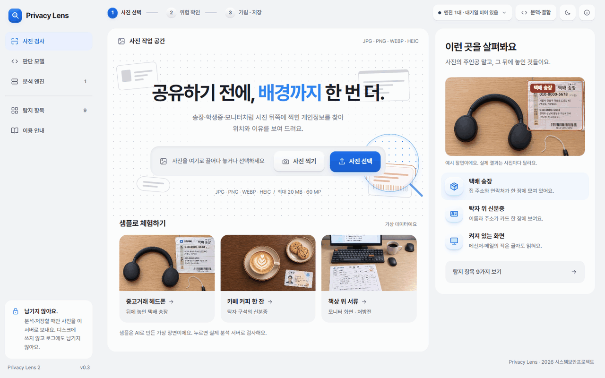
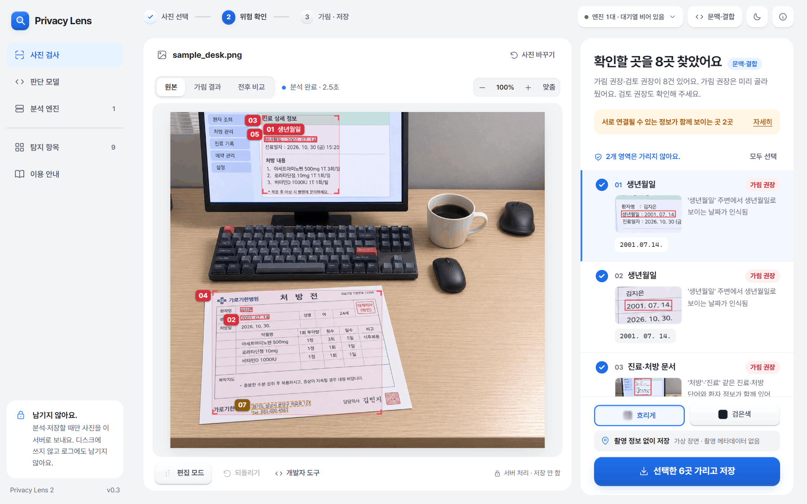
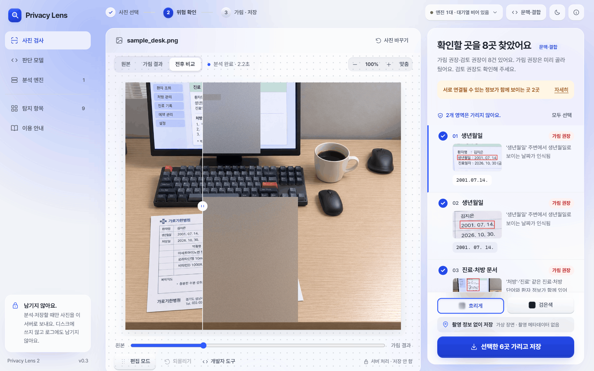
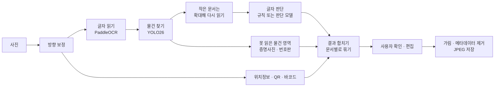

<div align="center">

# Privacy Lens

**사진을 올리기 전, 배경 속 개인정보까지.**

일상 사진에 나도 모르게 작게 찍힌 택배 송장, 신분증, 카드, 모니터 화면을 찾아<br>
위치와 이유를 보여 주고, 물건째 가린 사본을 만듭니다.


[주요 기능](#주요-기능) · [빠른 시작](#빠른-시작) · [작동 방식](#작동-방식) · [개발](#개발) · [문서](#문서)

수원대학교 정보보호학과 · 시스템보안프로젝트 · 2026학년도 2학기 · 5인 팀

</div>



<p align="center"><sub>화면 속 사진·인물·개인정보는 모두 생성형 AI로 만든 가상 샘플입니다.</sub></p>

## 왜 필요한가

사진을 찍을 때 우리는 찍고 싶은 것만 봅니다. 카페 탁자 위 학생증, 책상 위 처방전, 헤드폰 뒤 택배 송장처럼 **의도하지 않았고, 작고, 흐리거나 반쯤 가려진** 개인정보는 사람이 찾기 어렵습니다. 이름만, 학과만 같은 조각도 모이면 사람이 특정됩니다.

Privacy Lens는 SNS·단톡방·블로그·중고거래에 사진을 보내기 전에 이런 정보를 찾아 주고, 사용자가 확인한 뒤 가려서 저장하게 돕습니다.

## 주요 기능

| | 기능 | 설명 |
|---|---|---|
| 1 | **찾아서 보여 주기** | 사진 속 글자를 읽어 이름·전화번호·이메일·주소·주민등록번호·생년월일·카드·계좌·비밀번호·학번·운송장·차량번호를 찾습니다. QR·바코드 내용과 EXIF 위치정보도 확인합니다. |
| 2 | **물건으로 알아보기** | 글자를 못 읽어도 신분증·결제 카드·송장·영수증·티켓·개인 서류·약 같은 건강 관련 물건, 증명사진, 번호판을 물건 단위로 찾습니다. |
| 3 | **왜 위험한지 설명** | 항목마다 **가림 권장 · 검토 권장 · 참고**로 나누고, 주변 문구를 근거로 이유를 보여 줍니다. |
| 4 | **물건째 가리기** | 의도치 않게 찍힌 물건은 사진의 목적이 아니므로 통째로 가립니다. 번호를 못 읽은 카드, 진료·처방 서류도 종이째 가립니다. |
| 5 | **직접 고치기** | 편집 모드에서 영역을 옮기고, 추가·삭제하고, 붓으로 칠해 가릴 수 있습니다. |
| 6 | **위치정보 삭제·저장** | 흐리게 또는 검은색으로 가린 결과를 미리 보고, 메타데이터를 지운 JPEG를 내려받거나 바로 공유합니다. |

<table>
  <tr>
    <td width="50%"></td>
    <td width="50%"></td>
  </tr>
  <tr>
    <td align="center"><b>분석 결과</b><br>찾은 위치와 판정 근거를 함께 보여 줍니다.</td>
    <td align="center"><b>전후 비교</b><br>처방전·모니터 화면을 종이째 가린 결과를 미리 봅니다.</td>
  </tr>
</table>

> 탐지 결과에는 누락이 있을 수 있습니다. 저장 전 미리보기에서 사진 전체를 확인하고, 필요한 영역은 직접 추가해 주세요.

## 빠른 시작

Python 3.10~3.13, CPU 기준입니다. NVIDIA GPU, Windows 상세, 문제 해결은 [설치와 운영](docs/SETUP.md)을 봅니다.

```bash
git clone https://github.com/2026-usw-project/privacy-lens.git
cd privacy-lens
python3.12 -m venv .venv && source .venv/bin/activate     # Windows: .venv\Scripts\Activate.ps1

python -m pip install --upgrade pip
python -m pip install torch torchvision --index-url https://download.pytorch.org/whl/cpu
python -m pip install -r requirements.txt
python -m pip install paddlepaddle==3.2.2 -i https://www.paddlepaddle.org.cn/packages/stable/cpu/
python -m pip install paddleocr

python -m pipeline.objects download    # 얼굴 검출 모델
python run.py                          # 환경 점검 → http://127.0.0.1:8000
```

- `run.py`는 환경을 점검한 뒤 **게이트웨이**(화면 + 대기열)와 **엔진 서버**(OCR·판단·가림) 1개를 함께 띄웁니다.
- 화면 상단이 `엔진 1대 · 대기열 비어 있음`으로 바뀌면 사진을 올리거나 가상 샘플 3장으로 체험할 수 있습니다.
- 물건·번호판 검출 모델(YOLO)은 팀 드라이브에서 받아 `models/`에 둡니다. 없어도 글자 기반 분석은 동작합니다. → [모델 받기](docs/SETUP.md#2-모델-받기적용)
- 엔진 서버를 여러 PC로 늘리기, 정적 배포, https, 환경변수, API → [설치와 운영](docs/SETUP.md)

## 작동 방식



1. **방향 보정** — EXIF 회전 정보를 화소에 반영합니다. 이후 모든 좌표는 이 기준의 원본 픽셀입니다.
2. **글자 읽기** — OCR이 글자와 위치(기울어진 글줄은 외곽선까지)를 읽습니다.
3. **물건 찾기** — YOLO26이 송장·신분증·카드·영수증 같은 물건을 찾습니다. 글자를 거의 못 읽은 작은 문서는 잘라 최대 3배 확대해 다시 읽습니다.
4. **글자 판단** — 주변 라벨, 같은 줄·다음 줄 관계로 개인정보인지 판정합니다. 판단 모델을 바꾸면 이 단계만 바뀝니다.
5. **글자 밖 정보** — 그래도 못 읽은 물건은 영역으로 알리고, 증명사진(YuNet)·번호판·EXIF 위치정보·QR·바코드를 더합니다.
6. **확인과 저장** — 같은 문서의 항목끼리 묶어 '함께 노출됨'을 안내합니다. 사용자가 고르고 고친 영역을 서버가 가리고, 메타데이터 없는 JPEG로 돌려줍니다.

**같은 숫자도 주변 문구에 따라 판정이 달라집니다.** (가상 정보 예시, 규칙 기반 판단)

| 인식한 내용 | 판정 | 근거 |
|---|---|---|
| `연락처 010-1234-5678` | **가림 권장** | 같은 줄 왼쪽에 개인정보 라벨이 있음 |
| `배송지 ○○로 208` 다음 줄 `101동 202호` | **가림 권장** | 다음 줄까지 이어진 배송지 |
| `운송장번호 6012-3456-7890` | 검토 권장 | 배송 조회에 쓰일 수 있는 번호 |
| `고객센터 1588-0011` | 참고 | 대표번호 대역 |
| 라벨 없는 `909266858784` | 참고 | 숫자만으로 종류를 확정하지 않음 |

결과는 **심각도**(색: 가림 권장 · 검토 권장 · 참고)와 **확실성**(선: 실선 내용 확인 · 파선 일부만 인식 · 점선 확인 불가)을 따로 표시합니다.

**판단 모델** — 기본은 규칙 기반 판단입니다. 화면의 판단 모델 창에서 ChatGPT · Gemini · Gemini Decision · Claude · OpenRouter · Ollama · OpenAI 호환 API로 바꿀 수 있습니다. **클라우드 공급자를 고르면 사진 속 글자가 그 회사로 전송**되므로 가상 사진에만 쓰고, 실사는 규칙 기반이나 로컬 Ollama로 검사합니다([D-15](docs/DECISIONS.md), [D-23](docs/DECISIONS.md)).

## 개인정보 보호 원칙

- **원본 비저장** — 사진은 메모리에서만 처리하고, 업로드 이미지와 OCR 원문을 디스크·로그·DB에 남기지 않습니다.
- **로컬 OCR** — 서버에 설치된 OCR로 분석합니다. 사진을 외부 OCR API로 보내지 않습니다.
- **추정하지 않음** — 읽지 못한 내용을 지어내거나 신원 특정 가능성을 점수로 매기지 않습니다. 사용자 문구는 `pipeline/wording.py` 한 곳에서 만듭니다.
- **링크 미접속** — QR에서 읽은 문자열만 검사하고 링크에 접속하지 않습니다.

## 알려진 한계

- 작거나 흐린 글자를 OCR이 못 읽으면 글자 기반 탐지가 빠집니다. 이때는 물건 검출이 안전장치지만, 그것도 작은 물건은 놓칠 수 있습니다.
- 라벨 없는 이름은 연락처·주소·명찰 같은 단서가 있을 때만 찾습니다.
- 맞닿은 서로 다른 종이가 한 문서로 묶이거나, 방향이 크게 다른 문서가 섞이면 판단이 어긋날 수 있습니다.
- 물건·번호판 모델은 해외·공개 데이터로 잰 성능이며, 팀이 찍은 한국 일상 사진으로 다시 재는 중입니다.
- 지금까지의 성능 수치는 합성 샘플·공개 데이터 기준이라 실사 성능을 뜻하지 않습니다. 측정 기록은 [개발 노트](docs/DEVELOPMENT.md#비교-실험)에 있습니다.

전체 목록은 [개발 노트 · 알려진 한계](docs/DEVELOPMENT.md#알려진-한계)를 봅니다.

## 개발

```text
privacy-lens/
├── run.py · run_gateway.py · run_backend.py   실행 진입점
├── gateway.py          화면 제공 · 대기열 하나 · 엔진 분산 · 상태 확인
├── server.py           엔진 서버(FastAPI): 분석 · 가림 API
├── pipeline/           OCR · 물건 검출 · 문맥 판단 · 판단 모델 · 가림 · 사용자 문구
├── web/frontend-demo/  화면(dist/ 가 편집 원본, privacy-lens.html 로 빌드)
├── vision/             YOLO 학습 도구(데이터·모델은 팀 드라이브)
├── eval/               판단 회귀 · 실사 실패 원인 · 판단 방법 비교 · 안정성 점검
├── samples/            가상 정보 합성 샘플 · 촬영용 소품
├── tests/              백엔드 테스트
└── docs/               설계 · 결정 · 계획 · 기록
```

```bash
python -m pytest tests                 # 백엔드 테스트(OCR 불필요)
python -m eval.judgment --check        # 판단 회귀 검사 — 판단 규칙을 고치면 필수
cd web/frontend-demo && node scripts/check.mjs && node scripts/check-contract.mjs && node scripts/build.mjs   # 화면을 고치면
```

PR을 올리면 CI(테스트 · 판단 회귀 · 화면 점검 · 합성 한 바퀴)가 돕니다. 실사 평가 절차는 [실사 평가 가이드](docs/REAL_PHOTO_GUIDE.md), 그 밖의 실험 명령은 [AGENTS.md](AGENTS.md#명령어)에 있습니다.

**협업 규칙**

- `feat/<모듈>-<내용>` 브랜치에서 작업하고, 리뷰 1인 승인 후 병합합니다. `main`에 직접 push하지 않습니다.
- 실사 이미지, OCR 원문, 실제 개인정보는 커밋·로그에 남기지 않습니다. 샘플과 정답에는 가상 정보만 씁니다.
- 문서·주석·커밋 메시지는 한국어, 식별자는 영어. 커밋은 `type(scope): 설명` 형식입니다.
- AI 코딩 도구를 쓴다면 [AGENTS.md](AGENTS.md)를 먼저 읽습니다.

## 문서

| 문서 | 내용 |
|---|---|
| [설치와 운영](docs/SETUP.md) | CPU·GPU 설치 · 모델 적용 · 엔진 늘리기 · 배포·https · 환경변수 · API |
| [1차 완성 계획](docs/PLAN_1ST.md) | 지금 문제 · 완료 기준 · 할 일과 담당 |
| [가림 기준표](docs/MASKING_CRITERIA.md) | 항목별 가림 / 확인 필요 / 가리지 않음 기준(초안) |
| [결정 사항](docs/DECISIONS.md) | 결정 이력과 미결 사항(D-01~D-23) |
| [개발 노트](docs/DEVELOPMENT.md) | 설계 원칙 · 판정 규칙 · 측정 기록 · 버그 기록 · 한계 |
| [아키텍처](docs/ARCHITECTURE.md) | 처리 흐름 · 모듈 구성 · API |
| [실사 평가 가이드](docs/REAL_PHOTO_GUIDE.md) | 촬영 · 개인정보 처리 · 정답 입력 · 평가 |
| [이미지 객체 작업 기록](docs/OBJECTS_REPORT.md) | 얼굴·증명사진·번호판 평가와 학습 |
| [YOLO 학습 도구](vision/README.md) · [PC 학습](docs/PC_TRAIN.md) | 일상 물건·문서 모델 데이터·학습·버전별 결과 |
| [화면 안내](web/frontend-demo/README.md) · [API 계약](web/frontend-demo/API_CONTRACT.md) | 화면 구조 · 검사와 빌드 · 요청·응답 형식 |
| [요구사항](docs/PRD.md) · [역할 분담](docs/ROLES.md) | 목표와 요구사항 · 역할별 범위(교체 전 폴더명 기준) |

## 팀

| 역할 | 담당 범위 |
|---|---|
| 1 · 데이터 구축 | 데이터 준비 · 라벨링 |
| 2 · 평가·통합 지원 | 평가 · 오류 재현 · 통합 확인 |
| 3 · AI 분석 | OCR · 개인정보 판정 |
| 4 · 백엔드 | API · 가림 처리 · 서버 운영 |
| 5 · 프론트엔드 | 결과 표시 · 영역 편집 · 저장 흐름 |
